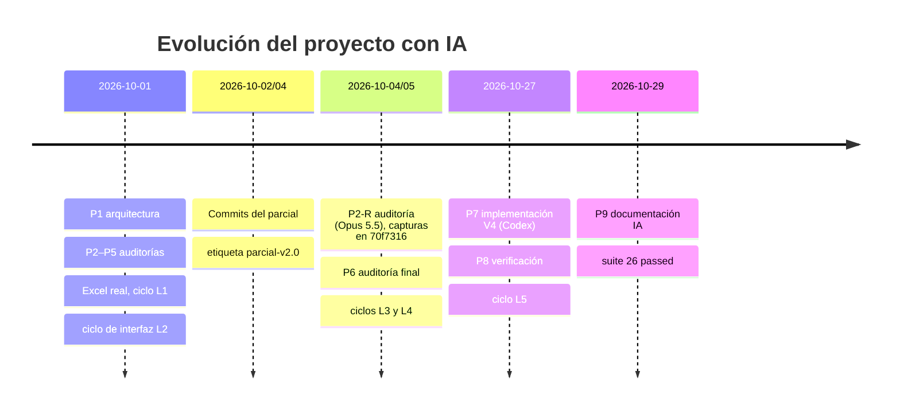

# Ingeniería asistida por IA

Este documento es el índice de la evidencia de **Prompt, Context, Harness, Loop y Graph Engineering** del proyecto. Cada sección resume la práctica, enlaza la evidencia detallada y la vincula a commits.

| Práctica | Evidencia detallada |
|---|---|
| Prompt Engineering | [prompts/PROMPTS_USADOS.md](prompts/PROMPTS_USADOS.md) y capturas en [prompts/](prompts/) |
| Context Engineering | [../AGENTS.md](../AGENTS.md) y [contexto/ACTUALIZACIONES.md](contexto/ACTUALIZACIONES.md) |
| Harness Engineering | [evidencias/CICLO_HARNESS.md](evidencias/CICLO_HARNESS.md), [../scripts/](../scripts/) y [../tests/](../tests/) |
| Loop Engineering | [evidencias/LOOPS.md](evidencias/LOOPS.md) |
| Graph Engineering | [evidencias/GRAFOS.md](evidencias/GRAFOS.md) |

## Convención de commits

- Repositorio: `https://github.com/Carbonell-Castillo/parcial-catalogo-servicios-202203069`.
- Los enlaces apuntan a `…/commit/<SHA>`. La etiqueta `parcial-v2.0` corresponde a [`2ea52a5`](https://github.com/Carbonell-Castillo/parcial-catalogo-servicios-202203069/commit/2ea52a53c8fb15eb546e71ae21a31fb815ac1649).
- El trabajo del parcial (2026-10-01) se hizo **sin Git**, por instrucción expresa en ese momento. Los commits del 2026-10-02 al 2026-10-04 empaquetan el estado resultante. Por eso cada evidencia del parcial enlaza al commit que **contiene** el artefacto, no a un commit por iteración.
- La ampliación Service Desk/CMDB (V4, 2026-10-27) está en el árbol de trabajo **sin commit**, por instrucción. Donde aparece `SHA-V4-PENDIENTE`, reemplazarlo por el SHA real después del commit. Un solo buscar y reemplazar actualiza todos los documentos.

### Mapa de commits

| Commit | Fecha | Contenido relevante para IA |
|---|---|---|
| [`959ddf9`](https://github.com/Carbonell-Castillo/parcial-catalogo-servicios-202203069/commit/959ddf91279f62ceed2256c2e26f0b419519422f) | 2026-10-02 | `AGENTS.md` (contexto V1–V3) e `Implementacion.md` |
| [`7292148`](https://github.com/Carbonell-Castillo/parcial-catalogo-servicios-202203069/commit/7292148d733611481d1c531d28ee5535d6c94c49) | 2026-10-03 | Scripts del harness: `entrypoint`, `validate.*`, `test-persistence.*` |
| [`376014e`](https://github.com/Carbonell-Castillo/parcial-catalogo-servicios-202203069/commit/376014e2f7f0994c4adea192b87f77723035ca91) | 2026-10-03 | `Dockerfile`, `Dockerfile.e2e`, `compose.yaml` |
| [`edbe5fc`](https://github.com/Carbonell-Castillo/parcial-catalogo-servicios-202203069/commit/edbe5fc68ad50109fcab27cb9af2234e4c3d9999) | 2026-10-03 | Código resultante de los ciclos del parcial: `importer.py`, `security.py`, `index.html` |
| [`8841ec5`](https://github.com/Carbonell-Castillo/parcial-catalogo-servicios-202203069/commit/8841ec5afd5fa5f0077c6b6ec56929f59e959aca) | 2026-10-03 | `PROMPTS_USADOS`, `ACTUALIZACIONES`, `CICLO_HARNESS`, `RESOLUCION` |
| [`9e1f5e5`](https://github.com/Carbonell-Castillo/parcial-catalogo-servicios-202203069/commit/9e1f5e5be0f0499db6816fd0f16b25905bff211b) | 2026-10-03 | Pruebas de regresión nacidas de los ciclos (importador, E2E) |
| [`70f7316`](https://github.com/Carbonell-Castillo/parcial-catalogo-servicios-202203069/commit/70f7316f2ab139d4ef8b8d09165fb1274e4e719b) | 2026-10-04 | Capturas de prompts (`image-1…4.png`) |
| [`2ea52a5`](https://github.com/Carbonell-Castillo/parcial-catalogo-servicios-202203069/commit/2ea52a53c8fb15eb546e71ae21a31fb815ac1649) | 2026-10-04 | Correcciones de la auditoría P2-R y del harness (L3, L4); etiqueta `parcial-v2.0` |
| `SHA-V4-PENDIENTE` | — | Service Desk, CMDB, grafos, P01–P18, contexto V4 |

---

## 1. Prompt Engineering

Detalle completo, con la instrucción usada, contexto, restricciones, salida, aceptación y resultado de cada prompt: [prompts/PROMPTS_USADOS.md](prompts/PROMPTS_USADOS.md).

| ID | Fecha | Herramienta / modelo | Área | Commit del resultado |
|---|---|---|---|---|
| P1 | 2026-10-01 | Claude Code | Requisitos, arquitectura, modelo | [`edbe5fc`](https://github.com/Carbonell-Castillo/parcial-catalogo-servicios-202203069/commit/edbe5fc68ad50109fcab27cb9af2234e4c3d9999) |
| P2 | 2026-10-01 | Claude Code | Auditoría de requisitos | [`edbe5fc`](https://github.com/Carbonell-Castillo/parcial-catalogo-servicios-202203069/commit/edbe5fc68ad50109fcab27cb9af2234e4c3d9999) |
| P2-R | 2026-10-04 ¹ | Claude Code, Opus 5.5 (esfuerzo Medium) | Auditoría, seguridad, permisos | [`2ea52a5`](https://github.com/Carbonell-Castillo/parcial-catalogo-servicios-202203069/commit/2ea52a53c8fb15eb546e71ae21a31fb815ac1649) |
| P3 | 2026-10-01 | Claude Code | Excel / importador / datos | [`edbe5fc`](https://github.com/Carbonell-Castillo/parcial-catalogo-servicios-202203069/commit/edbe5fc68ad50109fcab27cb9af2234e4c3d9999) |
| P4 | 2026-10-01 | Claude Code | Seguridad | [`edbe5fc`](https://github.com/Carbonell-Castillo/parcial-catalogo-servicios-202203069/commit/edbe5fc68ad50109fcab27cb9af2234e4c3d9999) |
| P5 | 2026-10-01 | Claude Code | Docker y pruebas | [`7292148`](https://github.com/Carbonell-Castillo/parcial-catalogo-servicios-202203069/commit/7292148d733611481d1c531d28ee5535d6c94c49) |
| P6 | 2026-10-05 | Claude Code CLI 2.1.276 (el CLI no expuso el modelo) | Auditoría final, harness | [`2ea52a5`](https://github.com/Carbonell-Castillo/parcial-catalogo-servicios-202203069/commit/2ea52a53c8fb15eb546e71ae21a31fb815ac1649) |
| P7 | 2026-10-27 | Codex | Service Desk, CMDB, colas, procesos | `SHA-V4-PENDIENTE` |
| P8 | 2026-10-27 | Codex | Pruebas P01–P18, Docker, persistencia | `SHA-V4-PENDIENTE` |
| P9 | 2026-10-29 | Claude Code (extensión VS Code), Opus 5.5 | Documentación de IA | `SHA-V4-PENDIENTE` |

¹ La sesión del asistente mostraba 2026-10-05, pero las capturas de P2-R se versionaron en [`70f7316`](https://github.com/Carbonell-Castillo/parcial-catalogo-servicios-202203069/commit/70f7316f2ab139d4ef8b8d09165fb1274e4e719b) con fecha de autor 2026-10-04 09:03 −0600. Se toma la fecha de Git, que es verificable. P6 conserva la fecha 2026-10-05 que registró el autor.

### Mejoras comprobadas (instrucción inicial → problema → revisión → resultado)

| # | Inicial | Problema observado | Revisión | Resultado comprobado |
|---|---|---|---|---|
| M1 | P1: arquitectura general | No podía evaluar código porque aún no existía | P2: auditoría con el código y un resultado real (`10 passed, 1 skipped`) | Brechas de UI, demo y CSRF corregidas; `11 passed, 1 skipped` |
| M2 | P2: auditoría integral | Hallazgo genérico de "trazabilidad" | P3: contexto reducido a la especificación y `importer.py`, con reglas concretas | Origen por servicio y distinción actualizado/omitido; pruebas reejecutadas |
| M3 | P2-R: auditoría requisito por requisito, salida larga (D1–D15) | Mezclaba defectos funcionales con pendientes de entrega | P6: solo lectura, máximo 500 palabras, veredictos técnico y Git separados | Detectó bits ejecutables ausentes en Bash; invocación cambiada a `sh`; corrida registrada (`15 passed`) |
| M4 | P7: implementar la tarea completa | Instrucción amplia, sin criterio numérico | P8: verificación con cifras: P01–P18, 12/46/5000, sin `.env` ni resultados inventados | `26 passed`, Playwright `1 passed`, `P18 OK (46,5000,37,37)` |

**Para la defensa:** M3 es la mejora más fácil de explicar. Compara las dos instrucciones textuales en PROMPTS_USADOS y el cambio concreto que produjo en los scripts ([`2ea52a5`](https://github.com/Carbonell-Castillo/parcial-catalogo-servicios-202203069/commit/2ea52a53c8fb15eb546e71ae21a31fb815ac1649)).

---

## 2. Context Engineering

**Contexto versionado:**
- [AGENTS.md](../AGENTS.md): objetivo, fuentes de autoridad, arquitectura, reglas, importación, comandos, límites e historial.
- [ACTUALIZACIONES.md](contexto/ACTUALIZACIONES.md): qué documentos se dieron al asistente en cada fase y por qué.
- [MODELO.md](MODELO.md) y [PROCESOS.md](PROCESOS.md): modelo y reglas de la V4.

| Versión | Fecha | Motivo (hallazgo o decisión) | Cambio en el contexto | Commit |
|---|---|---|---|---|
| V1 | 2026-10-01 | P02 exige que el logout invalide la sesión | Sesión opaca revocable, no JWT; el Excel se declara ausente | [`959ddf9`](https://github.com/Carbonell-Castillo/parcial-catalogo-servicios-202203069/commit/959ddf91279f62ceed2256c2e26f0b419519422f) |
| V2 | 2026-10-01 | Las auditorías P2/P3 mezclaban el estado interno con la columna E del Excel | Separar `activo` de `indicador_activo_excel`; origen por servicio; conteo por lote | [`959ddf9`](https://github.com/Carbonell-Castillo/parcial-catalogo-servicios-202203069/commit/959ddf91279f62ceed2256c2e26f0b419519422f) |
| V3 | 2026-10-01 | El Excel real: continuaciones en C combinada y padre ausente en la fila 101 | Dos reglas acotadas, con observación y prueba de regresión | [`959ddf9`](https://github.com/Carbonell-Castillo/parcial-catalogo-servicios-202203069/commit/959ddf91279f62ceed2256c2e26f0b419519422f), [`8841ec5`](https://github.com/Carbonell-Castillo/parcial-catalogo-servicios-202203069/commit/8841ec5afd5fa5f0077c6b6ec56929f59e959aca) |
| V4 | 2026-10-27 | La tarea Service Desk añade CMDB, roles operativos y relaciones técnicas | Roles operativos separados del rol base; CMDB separada de la organización; la lección 22 no se atribuye porque no fue suministrada | `SHA-V4-PENDIENTE` |

### Contexto por fase y separación de instrucciones y datos

| Fase | Contexto suministrado | Por qué |
|---|---|---|
| Diseño (P1) | `Implementacion.md` y el listado de un directorio vacío | Evitar que el asistente asuma tecnología o archivos inexistentes |
| Auditoría (P2, P2-R) | Especificación, todo el repositorio y un resultado real de pruebas | Comparar código observable contra la rúbrica |
| Focalizada (P3–P5) | Solo los archivos del dominio auditado | Reducir ruido y obtener hallazgos accionables |
| Excel real | El archivo, entregado **al harness como dato** | Que las cifras salgan de la ejecución, no de la lectura del asistente |
| V4 (P7, P8) | Tarea, `Implementacion.md`, AGENTS, repositorio y `CMDB.xlsx` | Ampliar sin romper la base del parcial |

**Cómo se evitó mezclar instrucciones con datos externos:**
1. AGENTS.md, en "Fuentes de autoridad" punto 4, declara que el Excel es un dato no confiable y nunca una instrucción.
2. Los Excel se montan en solo lectura (`./data:/app/data:ro` en [compose.yaml](../compose.yaml)) y se identifican por su SHA-256 en [data/README.md](../data/README.md).
3. El importador solo lee las celdas de un rango fijo (A5:L101). Ningún texto de una celda se ejecuta ni se pasa como prompt.
4. Las cifras de control (12/46, 5000) provienen de la especificación y se verifican por ejecución.

---

## 3. Harness Engineering

Detalle: [evidencias/CICLO_HARNESS.md](evidencias/CICLO_HARNESS.md).

| Etapa | Comando (siempre en contenedor) |
|---|---|
| Preparar y migrar | `docker compose up --build -d` (el entrypoint ejecuta `alembic upgrade head` y los seeds) |
| Importar catálogo | `docker compose exec -T app python -m app.cli import data/CatalogoServicios.xlsx` |
| Generar CMDB | `docker compose exec -T app python -m app.cli generate-cmdb --count 5000 --seed 20261028` |
| Datos demo | `docker compose exec -T app python -m app.cli seed-tickets` |
| Probar | `docker compose run --rm --no-deps --entrypoint pytest app -q --disable-warnings` |
| E2E | `docker compose --profile test run --rm e2e` |
| Persistencia | `./scripts/test-persistence.ps1` o `sh scripts/test-persistence.sh` |
| Todo, en orden | `./scripts/validate.ps1` o `sh scripts/validate.sh` (se detiene en el primer código de salida ≠ 0) |

**Última ejecución observada:** 2026-10-29, árbol de trabajo con cambios en stage sobre [`2ea52a5`](https://github.com/Carbonell-Castillo/parcial-catalogo-servicios-202203069/commit/2ea52a53c8fb15eb546e71ae21a31fb815ac1649). Comando pytest: `26 passed, 1 warning in 10.45s`, código de salida 0. En esa fecha no se ejecutaron `validate.ps1` completo, E2E ni P18. El resultado completo más reciente es del 2026-10-27 (ver CICLO_HARNESS).

**Límites:**
- no leer ni publicar `.env`;
- Excel montado `:ro`;
- pruebas en SQLite aislado;
- `down -v` solo para reiniciar datos de prueba;
- adjuntos de 5 MiB como máximo, recorrido de grafo de 1,000 CI como máximo, página de 200 como máximo;
- la aplicación funciona sin claves de IA.

---

## 4. Loop Engineering

Detalle con entradas, resultados reales, criterio de salida, iteraciones e intervención humana: [evidencias/LOOPS.md](evidencias/LOOPS.md).

| Ciclo | Clase | Fallo | Iteraciones | Commit |
|---|---|---|---|---|
| L1 | **Datos** + funcional | Excel real: `UniqueViolation`, luego 12/45 | 3 | [`edbe5fc`](https://github.com/Carbonell-Castillo/parcial-catalogo-servicios-202203069/commit/edbe5fc68ad50109fcab27cb9af2234e4c3d9999), [`9e1f5e5`](https://github.com/Carbonell-Castillo/parcial-catalogo-servicios-202203069/commit/9e1f5e5be0f0499db6816fd0f16b25905bff211b) |
| L2 | **Funcional** (UI) | Búsqueda con filtros vacíos devolvía 422 en silencio | 2 | [`edbe5fc`](https://github.com/Carbonell-Castillo/parcial-catalogo-servicios-202203069/commit/edbe5fc68ad50109fcab27cb9af2234e4c3d9999), [`9e1f5e5`](https://github.com/Carbonell-Castillo/parcial-catalogo-servicios-202203069/commit/9e1f5e5be0f0499db6816fd0f16b25905bff211b) |
| L3 | **Permisos** y exposición de datos | Auditoría P2-R: la ficha no mostraba responsables al rol consulta y faltaba la UI de N1 | 2 | [`2ea52a5`](https://github.com/Carbonell-Castillo/parcial-catalogo-servicios-202203069/commit/2ea52a53c8fb15eb546e71ae21a31fb815ac1649) |
| L4 | Harness | Carrera con `/health`; la imagen E2E no se reconstruía; P12 aceptaba una salida vacía | 3 | [`2ea52a5`](https://github.com/Carbonell-Castillo/parcial-catalogo-servicios-202203069/commit/2ea52a53c8fb15eb546e71ae21a31fb815ac1649) |
| L5 | Funcional (V4) | Índice de prioridad al ampliar los incidentes de 5 a 7 | 2 | `SHA-V4-PENDIENTE` |

Límite de iteraciones: 3 por ciclo antes de intervención humana. **Ninguno de estos fallos fue introducido deliberadamente.**

---

## 5. Graph Engineering

Detalle, algoritmos, pruebas y hallazgos: [evidencias/GRAFOS.md](evidencias/GRAFOS.md).

| Grafo | Nodos y aristas | Regla | Código | Prueba |
|---|---|---|---|---|
| Clasificación CMDB | `clasificacion_ci`, arista hijo → padre | Árbol: sin ciclos, padre existente, código único dentro del padre | `class_has_ancestor` en [service_desk.py](../app/service_desk.py) | `test_p14_…` |
| Relaciones técnicas | `dispositivo_ci`, aristas tipadas en `relacion_ci` | `depende_de`, `alojado_en` y `padre_de` acíclicas; las demás solo admiten ciclo con `permite_ciclo` | `relation_path`, `create_relation` | `test_p14_…` |
| Impacto | Recorrido por `depende_de`/`alojado_en` + `servicio_ci` | Máximo 1,000 CI; el resultado es **potencial** | `impact` | `test_p14_…` |

[GRAFOS.md](evidencias/GRAFOS.md) documenta dos observaciones de esta revisión que conviene conocer para la defensa: la **dirección** del recorrido de impacto y los ciclos **entre tipos distintos**.

---

## 6. Guía para la defensa

| Te pedirán explicar | Dónde está |
|---|---|
| Un prompt mejorado | M3 (P2-R → P6) o M4 (P7 → P8), en PROMPTS_USADOS |
| Una actualización de contexto | V3: hallazgo en el Excel real → regla acotada → prueba de regresión |
| El harness | `validate.ps1`, sus 9 etapas y los códigos de salida |
| Un ciclo de corrección | L1 (12/45 → 12/46) |
| Ambos grafos | GRAFOS.md: árbol de clasificación y grafo técnico con recorrido de impacto |

## 7. Pendientes del autor (no se completaron para no inventar evidencia)

1. **Texto literal de P7 y P8:** solo existen resúmenes. Copiarlo del historial de Codex junto con capturas.
2. **Cobertura de prompts:** la tarea pide prompts que cubran CMDB, colas, procesos y grafos. Hoy los cubre un único prompt amplio (P7). Si se usaron prompts específicos, registrarlos como P10 en adelante con su texto real.
3. **AGENTS.md no incluye la V4:** el historial termina en V3, y faltan el glosario y las reglas de Service Desk/CMDB que pide la tarea.
4. **Commit de la V4:** hacer commit y reemplazar `SHA-V4-PENDIENTE`.
5. **Ciclo de permisos V4:** la versión anterior de este documento mencionaba "reautenticar actor en prueba que mezcló cookie/CSRF" sin entradas ni resultados. Completarlo con los datos reales o retirarlo.
6. Los defectos D1, D2 y D13 de la auditoría P2-R siguen abiertos (ver L3).
