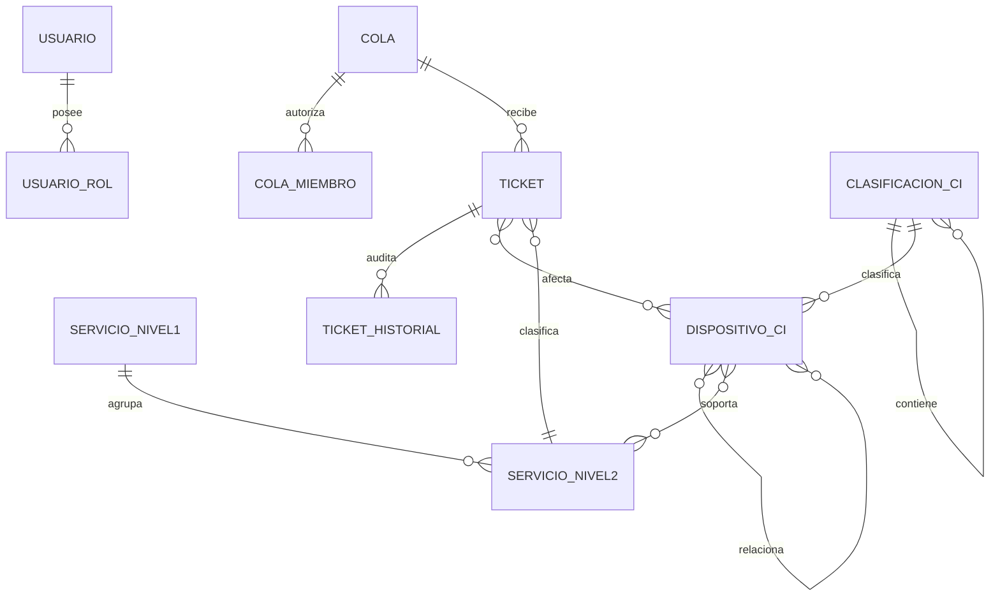
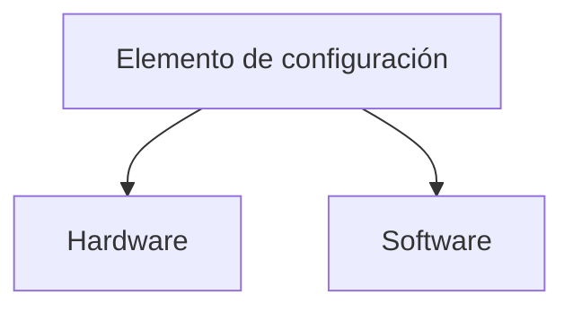

# Modelo, diccionario y fuentes

Organización y CMDB son jerarquías separadas.

Fuente: `CMDB.xlsx`, hoja `CMDB`, encabezado C4 y valores C5:C6. La raíz es contenedor del proyecto. La lección 22 no está en el repositorio; no se le atribuyen niveles no verificables.

| Excel | Modelo |
|---|---|
| B/C/D | nombre, clasificación, `atributos.descripcion` |
| E/F/G | serie, versión, adquisición |
| H/I/J/K | estado, relaciones, ubicación |
| L | responsable sintético FK |
| M–P | historial, tickets y atributos |
| Q–S | seguridad, cumplimiento, configuración |
| T/U | licencia y vencimiento |

Agregados del proyecto: id, etiqueta, baja lógica, timestamps, responsable FK y JSON por clase. IP es opcional y solo se genera en Hardware. La jerarquía prohíbe ciclos; `depende_de`, `alojado_en` y `padre_de` son acíclicas.

| Entidad | Restricciones |
|---|---|
| cola | código único, un proceso, nivel 0–4, objetivos calendario |
| cola_miembro/rol | cinco permisos separados |
| ticket | número único, servicio N2 y proceso/cola coherentes |
| ticket_historial | actor, fecha, antes/después y motivo; sin eliminación API |
| adjunto | autor, MIME permitido y tamaño ≤5 MiB |
| clasificación/CI | código por padre, etiqueta/serie únicas |
| relaciones | origen/destino/tipo únicos y política de ciclo |

El generador usa `SYN-{semilla}-{secuencia}`; repetir semilla omite existentes.
