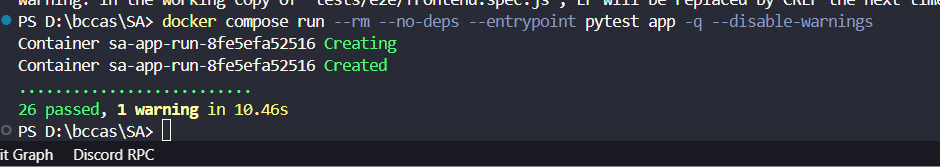
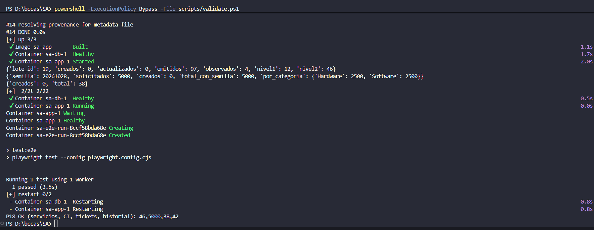

# Pruebas y evidencia

`docker compose run --rm --no-deps --entrypoint pytest app -q --disable-warnings`

| ID | Automatización |
|---|---|
| P01–P02 | aceptación e importador: auth, 12/46, SE.12, NULL |
| P03–P04 | generador 5,000, idempotencia y ciclos |
| P05–P08 | referencias, permisos, reclamo único y transferencia |
| P09–P10 | siete rutas, transiciones/aprobaciones inválidas |
| P11–P12 | E0–E3, I0–I6 y regla temporal |
| P13 | API de relaciones entre tickets |
| P14 | recorrido CI→servicio y ciclos técnicos |
| P15 | cierre, reapertura y actor |
| P16 | filtros/página sobre ≥5,000 |
| P17 | indicadores controlados |
| P18 | `scripts/test-persistence.*` tras reinicio |

