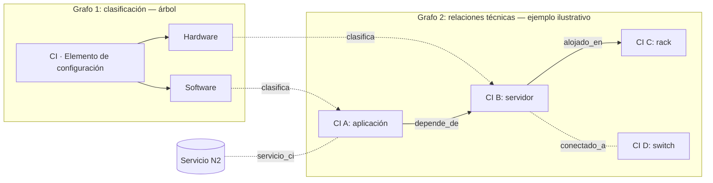

# Graph Engineering: los dos grafos de la CMDB

Índice general: [../IA.md](../IA.md). Código: [app/service_desk.py](../../app/service_desk.py). Modelo: [../MODELO.md](../MODELO.md). Commit: `SHA-V4-PENDIENTE`.

La tarea exige distinguir la **jerarquía de clasificación**, que es un árbol, de las **relaciones técnicas** entre CI, que forman un grafo dirigido y tipado. Son estructuras separadas, con tablas y reglas distintas.



El grafo 1 refleja los datos reales del seed. **El grafo 2 es un ejemplo para explicar el concepto**: el seed actual no genera relaciones técnicas ([app/demo.py](../../app/demo.py)), así que en la base solo existen las que se crean por API o en las pruebas.

---

## Grafo 1 — Jerarquía de clasificación

| Aspecto | Implementación |
|---|---|
| Tabla | `clasificacion_ci` (`id`, `codigo`, `nombre`, `padre_id`, `atributos_definidos`, `origen`, `activo`) |
| Arista | hijo → padre (`padre_id`); cada nodo tiene como máximo un padre |
| Fuente | `CMDB.xlsx`, hoja `CMDB`, encabezado C4 y valores C5:C6 (Hardware, Software). La raíz `CI` es un contenedor de navegación del proyecto, declarado en el campo `origen` |
| Lección 22 | No fue suministrada. No se le atribuyen niveles que no se puedan verificar (ver [MODELO.md](../MODELO.md)) |
| Reglas | Padre existente (`422`), código único dentro del padre (`409`), **sin ciclos** (`409`) |
| Consulta | `GET /api/cmdb/dispositivos/{id}` devuelve `clasificacion_completa`, la cadena desde la raíz hasta la hoja |

### Algoritmo anticiclos (`class_has_ancestor`)

Para mover el nodo `X` bajo un nuevo padre `P`, se sube desde `P` por los `padre_id`. Si en el camino aparece `X`, el cambio crearía un ciclo y se rechaza.

```
start = P
mientras start:
    si start == X        → ciclo
    si start ya visitado → ciclo (defensa ante datos corruptos)
    start = padre(start)
```

- **Costo:** O(profundidad del árbol). Una consulta por nivel.
- **Rechazo directo:** `P == X` (ser padre de sí mismo).
- **Prueba:** `test_p14_cmdb_cycles_traversal_and_p16_pagination` intenta poner la raíz bajo su hijo y espera `409`.

---

## Grafo 2 — Relaciones técnicas entre CI

| Aspecto | Implementación |
|---|---|
| Nodos | `dispositivo_ci`, con al menos 5,000 sintéticos (`SYN-{semilla}-{secuencia}`) |
| Aristas | `relacion_ci (origen_id, destino_id, tipo, permite_ciclo)`, con `UNIQUE(origen, destino, tipo)` |
| Semántica | `A depende_de B` significa que A necesita a B; `B alojado_en C` significa que B está físicamente en C |
| Tipos acíclicos | `RELACIONES_ACICLICAS = {depende_de, alojado_en, padre_de}` |
| Otros tipos | Por ejemplo `conectado_a`: acíclicos por defecto; admiten ciclo solo con `permite_ciclo=true` |
| Vínculo con servicios | `servicio_ci (servicio_id, ci_id)` |
| Vínculo con tickets | `ticket_ci`; la ficha del CI lista hasta 100 tickets |

### Validación de ciclos (`relation_path` + `create_relation`)

Insertar `origen → destino` crea un ciclo si ya existe un camino `destino → … → origen`. Antes de insertar se hace un recorrido en profundidad desde `destino`, siguiendo solo aristas **del mismo tipo**. Si se alcanza `origen`, se responde `409 "La relación produciría un ciclo no permitido"`.

Otros rechazos: autorrelación o CI inexistente (`422`) y relación duplicada (`409`).

**Prueba:** `test_p14_…` crea `ci depende_de other` (`201`) y luego `other depende_de ci` (`409`).

### Recorrido de impacto (`GET /api/cmdb/dispositivos/{id}/impacto`)

1. Recorrido en profundidad desde el CI, siguiendo las aristas salientes `depende_de` y `alojado_en`.
2. Se detiene a los **1,000 CI** visitados, que es un límite de operación.
3. Reúne los servicios `servicio_ci` de todos los CI visitados.
4. Devuelve `ci_recorridos`, `relaciones` y `servicios_potencialmente_afectados`, junto con la advertencia: *"Una dependencia indica impacto potencial, no prueba una interrupción efectiva."*

**Prueba:** `test_p14_…` vincula un servicio a `other`, consulta el impacto de `ci` (que `depende_de other`) y verifica que el servicio aparezca.

---

## Observaciones de esta revisión (2026-10-29)

Detectadas al documentar con P9. **No se modificó el código.** Conviene conocerlas para la defensa.

### O1 — Dirección del recorrido de impacto

El recorrido sigue las aristas **salientes** (`origen == actual → destino`). Para `A depende_de B`, consultar el impacto de **A** visita **B** y devuelve los servicios de B. Eso responde *"¿de qué depende A?"*, un análisis hacia la causa.

La pregunta de la tarea es *"¿qué servicios se ven afectados **por** un CI?"*. Si **B** falla, se ven afectados quienes dependen de B, es decir, A y sus servicios. Eso exige recorrer las aristas **entrantes** (`destino == actual → origen`). Con el código actual, consultar el impacto de B no devuelve los servicios de A.

**Opciones:**
- **Corregir:** en `impact`, consultar `RelacionCI.destino_id == cur` y apilar `r.origen_id`. Habría que ajustar `test_p14_…`, que hoy fija la dirección saliente.
- **Documentar** la semántica actual como decisión ("dependencias del CI") y añadir la consulta inversa.

### O2 — Ciclos entre tipos distintos

`relation_path` solo busca caminos del **mismo tipo**. Por eso `A depende_de B` junto con `B alojado_en A` se acepta, aunque el recorrido de impacto trate ambos tipos como un solo grafo. Hay dos salidas:
- validar con el conjunto `{depende_de, alojado_en}` para los tipos que el impacto recorre juntos;
- o declarar explícitamente que la aciclicidad se garantiza por tipo.

### O3 — Sin relaciones en los datos demo

El generador crea 5,000 CI pero ninguna relación. Para demostrar el recorrido en la defensa hay que crear relaciones por API, o añadir al seed un conjunto pequeño y determinista de relaciones.

---

## Cómo demostrarlo en vivo

```powershell
# sesión de administrador
$s = New-Object Microsoft.PowerShell.Commands.WebRequestSession
$r = Invoke-RestMethod http://localhost:8000/api/auth/login -Method Post -WebSession $s `
     -ContentType 'application/json' -Body '{"login":"admin","password":"Admin-Demo-2026!"}'
$h = @{'X-CSRF-Token'=$r.csrf}

# dos CI cualesquiera de la página 1
$ci = (Invoke-RestMethod "http://localhost:8000/api/cmdb/dispositivos?size=2" -WebSession $s).items
$a = $ci[0].id; $b = $ci[1].id

# A depende_de B → 201 ; B depende_de A → 409 (ciclo)
Invoke-RestMethod http://localhost:8000/api/cmdb/relaciones -Method Post -WebSession $s -Headers $h `
  -ContentType 'application/json' -Body (@{origen_id=$a;destino_id=$b;tipo='depende_de'} | ConvertTo-Json)
Invoke-RestMethod http://localhost:8000/api/cmdb/relaciones -Method Post -WebSession $s -Headers $h `
  -ContentType 'application/json' -Body (@{origen_id=$b;destino_id=$a;tipo='depende_de'} | ConvertTo-Json)

# recorrido de impacto y clasificación completa
Invoke-RestMethod "http://localhost:8000/api/cmdb/dispositivos/$a/impacto" -WebSession $s
(Invoke-RestMethod "http://localhost:8000/api/cmdb/dispositivos/$a" -WebSession $s).clasificacion_completa
```

Si cambiaste las contraseñas demo en `.env`, usa esos valores. Las relaciones creadas quedan en la base de evaluación y la API no tiene un endpoint para eliminarlas. Ensaya en un entorno que puedas reiniciar con `down -v`, o acepta que esas relaciones permanezcan.
