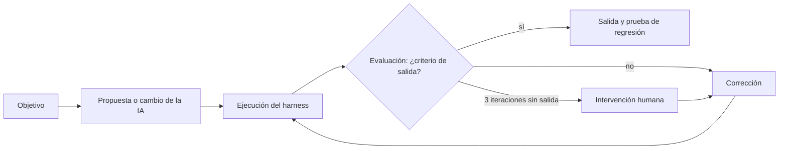
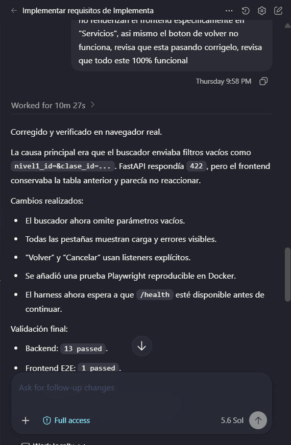

# Loop Engineering: ciclos documentados

Índice general: [../IA.md](../IA.md). Cada ciclo sigue el esquema exigido:

**Reglas comunes:**
- **Límite:** 3 iteraciones por ciclo. Si se superan, se detiene el ciclo y decide una persona.
- **Evaluación:** siempre por ejecución en contenedor (pytest, importación, Playwright o scripts), nunca por lectura del asistente.
- **Fallos deliberados:** ninguno. Todos los fallos de esta página ocurrieron en el desarrollo real.
- **Commits:** el parcial se desarrolló sin Git, así que L1 y L2 enlazan el commit que contiene el código y la prueba resultantes. L5 está pendiente de commit (`SHA-V4-PENDIENTE`).

| Ciclo | Clase exigida | Iteraciones | Salida |
|---|---|---|---|
| [L1](#l1--importación-del-excel-real) | Problema de **datos** + defecto funcional | 3 | 12/46 idempotente |
| [L2](#l2--búsqueda-y-navegación-de-la-interfaz) | Defecto **funcional** | 2 | Playwright `1 passed` |
| [L3](#l3--auditoría-de-permisos-y-exposición-de-datos) | **Permisos** / exposición de datos | 2 | `15 passed` (parcial) |
| [L4](#l4--fallos-del-propio-harness) | Harness | 3 | `validate.ps1` con código 0 |
| [L5](#l5--prioridades-al-ampliar-incidentes-v4) | Funcional (V4) | 2 | `26 passed`, `P18 OK` |

---

## L1 — Importación del Excel real

| Campo | Contenido |
|---|---|
| Fecha | 2026-10-01 |
| Objetivo | Importar `data/CatalogoServicios.xlsx` con exactamente 12 N1 y 46 N2, de forma idempotente |
| Entrada | Excel original (SHA-256 en [data/README.md](../../data/README.md)) y un importador validado solo con el fixture sintético |
| Comando | `docker compose exec -T app python -m app.cli import data/CatalogoServicios.xlsx` |
| Criterio de salida | `nivel1=12`, `nivel2=46` y una segunda carga con `creados=0` |
| Intervención humana | Aprobar la regla acotada de la fila 101 como **decisión del proyecto**, registrada en AGENTS.md V3, en lugar de una propagación genérica |

| Iteración | Resultado real | Evaluación | Corrección |
|---|---|---|---|
| 1 | `UniqueViolation` en `SE.01.01` | C5:C7 es una sola combinación; cada fila se trataba como alta | Detectar el ancla de la combinación en la columna C y omitir las filas de continuación |
| 2 | 12 N1 / **45** N2 | El control de conteo del lote ([importer.py](../../app/importer.py)) marcó que faltaba uno | Investigación: `SE.12.3` en la fila 101 tiene A/B vacías **fuera** de una combinación |
| 3 | 12 / 46; lote 1 `creados=58`, lote 2 `creados=0, actualizados=0` | Criterio cumplido | Regla limitada a fila 101 + `SE.12.3`, con observación `padre_inferido_se12` |

- **Regresión:** `test_merged_n2_continuation_creates_only_anchor_service` y `test_original_excel_has_required_counts`.
- **Commits:** código en [`edbe5fc`](https://github.com/Carbonell-Castillo/parcial-catalogo-servicios-202203069/commit/edbe5fc68ad50109fcab27cb9af2234e4c3d9999), pruebas en [`9e1f5e5`](https://github.com/Carbonell-Castillo/parcial-catalogo-servicios-202203069/commit/9e1f5e5be0f0499db6816fd0f16b25905bff211b), contexto V3 en [`959ddf9`](https://github.com/Carbonell-Castillo/parcial-catalogo-servicios-202203069/commit/959ddf91279f62ceed2256c2e26f0b419519422f).

## L2 — Búsqueda y navegación de la interfaz

| Campo | Contenido |
|---|---|
| Fecha | 2026-10-01 |
| Objetivo | Que las pestañas, la búsqueda de Servicios y el botón "Volver" funcionen en un navegador real |
| Entrada | Reporte humano: "no renderizan el frontend… el botón de volver no funciona" (captura abajo) |
| Comando | Reproducción con Playwright en Chrome; luego `docker compose --profile test run --rm e2e` |
| Criterio de salida | E2E `1 passed` y backend sin regresiones |
| Intervención humana | El reporte inicial fue humano: ninguna prueba automática cubría la interfaz |

| Iteración | Resultado real | Evaluación | Corrección |
|---|---|---|---|
| 1 | La búsqueda conservaba la tabla anterior | Se enviaba `nivel1_id=&clase_id=…`; FastAPI respondía 422 y la UI no lo mostraba | Construir la query solo con valores no vacíos; mostrar los estados de carga y error; listeners explícitos en Volver/Cancelar |
| 2 | Backend `13 passed`, E2E `1 passed` | Criterio cumplido | Se creó la prueba [frontend.spec.js](../../tests/e2e/frontend.spec.js) |

- **Commits:** [`edbe5fc`](https://github.com/Carbonell-Castillo/parcial-catalogo-servicios-202203069/commit/edbe5fc68ad50109fcab27cb9af2234e4c3d9999) (`index.html`), [`9e1f5e5`](https://github.com/Carbonell-Castillo/parcial-catalogo-servicios-202203069/commit/9e1f5e5be0f0499db6816fd0f16b25905bff211b) (E2E), [`376014e`](https://github.com/Carbonell-Castillo/parcial-catalogo-servicios-202203069/commit/376014e2f7f0994c4adea192b87f77723035ca91) (`Dockerfile.e2e`).

## L3 — Auditoría de permisos y exposición de datos

| Campo | Contenido |
|---|---|
| Fecha | 2026-10-04 (ver la nota de fecha en IA.md) |
| Objetivo | Comprobar requisito por requisito que roles, relaciones y ficha cumplen `Implementacion.md` |
| Entrada | Prompt P2-R (Claude Code, Opus 5.5) sobre el repositorio en [`9e1f5e5`](https://github.com/Carbonell-Castillo/parcial-catalogo-servicios-202203069/commit/9e1f5e5be0f0499db6816fd0f16b25905bff211b) (HEAD en ese momento) |
| Comando | `docker compose run --rm --no-deps --entrypoint pytest app -q`, más sondas HTTP temporales fuera del repositorio |
| Criterio de salida | Veredicto técnico PASS y pruebas de regresión para cada defecto corregido |
| Intervención humana | La persona eligió qué defectos corregir antes de la entrega; D1, D2 y D13 se dejaron abiertos y declarados |

| Iteración | Resultado real | Evaluación | Corrección |
|---|---|---|---|
| 1 | `13 passed`, pero veredicto **FAIL condicionado**. Sondas: mover al responsable → `200`; reactivar un área bajo una empresa inactiva → `200`; consulta en `/api/usuarios` → `403`; un admin se desactiva a sí mismo → `200` | La suite verde no cubría estas reglas | Nombres de sección y usuario responsables en `service_dict` (visibles al rol consulta sin abrir `/api/usuarios`); CRUD de N1 en la UI; ficha con origen y código original |
| 2 | `15 passed` (P6 / `validate.ps1`, 2026-10-05) | Criterio cumplido para lo corregido | Pruebas `test_service_detail_includes_responsible_names` y `test_level1_crud_and_active_dependency_policy` |

- **Commit:** [`2ea52a5`](https://github.com/Carbonell-Castillo/parcial-catalogo-servicios-202203069/commit/2ea52a53c8fb15eb546e71ae21a31fb815ac1649).
- **Abierto:** D1 (asignación de responsable desfasada), D2 (reactivación bajo un padre inactivo) y D13 (autodesactivación del administrador).

## L4 — Fallos del propio harness

| Campo | Contenido |
|---|---|
| Fecha | 2026-10-01 y 2026-10-05 |
| Objetivo | Que `scripts/validate.ps1` recorra todo el flujo y termine con código 0 de forma confiable |
| Comando | `powershell -ExecutionPolicy Bypass -File scripts/validate.ps1` |
| Criterio de salida | Código 0 con pytest, E2E, importación y P12 verdes |
| Intervención humana | Ninguna; los fallos los detectó el propio harness |

| Iteración | Resultado real | Evaluación | Corrección |
|---|---|---|---|
| 1 | Fallo intermitente: Compose devolvía el control antes de que `/health` aceptara conexiones | Condición de carrera | Reintentos de hasta 90 s en `validate.ps1` y `validate.sh` |
| 2 | La imagen E2E no se reconstruía; P12 aceptaba una salida vacía de `psql` | Falso positivo posible | `docker compose --profile test build`; P12 con reintentos y exigencia de valor no vacío y `/health` |
| 3 | `15 passed`, Playwright `1 passed`, 12/46 con `creados=0`, `P12 OK` | Criterio cumplido | — |

- **Commits:** scripts iniciales en [`7292148`](https://github.com/Carbonell-Castillo/parcial-catalogo-servicios-202203069/commit/7292148d733611481d1c531d28ee5535d6c94c49), correcciones en [`2ea52a5`](https://github.com/Carbonell-Castillo/parcial-catalogo-servicios-202203069/commit/2ea52a53c8fb15eb546e71ae21a31fb815ac1649).

## L5 — Prioridades al ampliar incidentes (V4)

| Campo | Contenido |
|---|---|
| Fecha | 2026-10-27 |
| Objetivo | Generar datos demo con incidentes I0–I6 (siete categorías) y pasar el harness V4 completo |
| Entrada | Prompt P8 (Codex); seeds `seed-tickets` y `generate-cmdb --seed 20261028` |
| Comando | `scripts/validate.ps1` |
| Criterio de salida | `26 passed`, E2E `1 passed`, 12/46, CMDB 5000 y `P18 OK` |
| Intervención humana | No registrada |

| Iteración | Resultado real | Evaluación | Corrección |
|---|---|---|---|
| 1 | Fallo por índice de prioridad | La lista de incidentes pasó de 5 a 7 elementos, pero la selección de prioridad suponía 5 | Selección modular del índice |
| 2 | `26 passed`, Playwright `1 passed`, 12/46, CMDB 5000 (2500 Hardware y 2500 Software), 37 tickets, `P18 OK (46,5000,37,37)` | Criterio cumplido | — |

- **Fuente:** [RESOLUCION §11](../RESOLUCION.md).
- **Verificación posterior:** 2026-10-29, pytest `26 passed, 1 warning in 10.45s`, código de salida 0.
- **Commit:** `SHA-V4-PENDIENTE`.

---

## Ciclo de permisos V4 (incompleto)

La versión anterior de `docs/IA.md` menciona un ciclo en el que una prueba "mezcló cookie/CSRF" y se corrigió reautenticando al actor. No hay registro de su entrada, sus resultados ni su fecha, así que **no se presenta como ciclo completo**. Completarlo con los datos reales o retirarlo.
