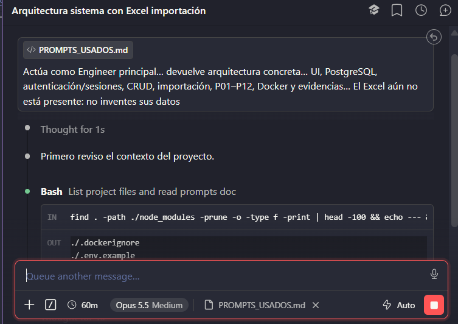
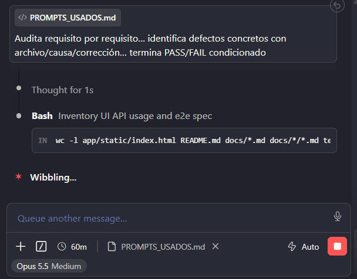
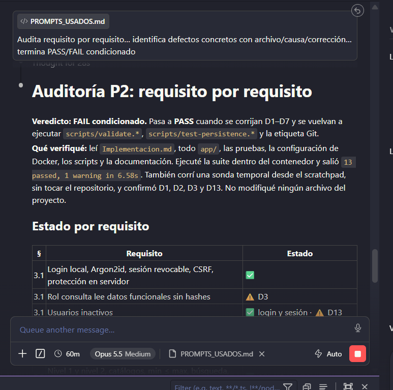
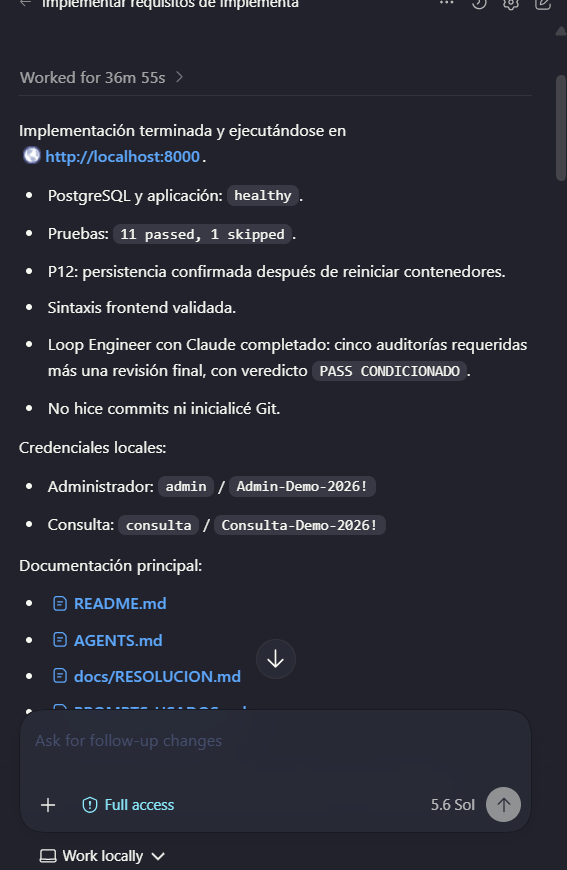

# Prompts utilizados

Índice general y commits: [../IA.md](../IA.md). Las instrucciones aparecen tal como se usaron. Los puntos suspensivos (`…`) son de la transcripción original, que conservó solo los fragmentos decisivos.

**Herramientas registradas:**
- **Claude Code** en el CLI (2.1.276) y en la extensión de VS Code. Las capturas `image.png`, `image-1.png` e `image-4.png` muestran el selector **Opus 5.5 · Medium**.
- **Codex**: según las capturas `image-2.png` e `image-3.png`, fue el agente que implementó el parcial y corrigió la interfaz. También implementó la V4 (P7 y P8). Claude Code actuó como auditor (P1–P6, P2-R) y documentador (P9).

Cuando la herramienta no expuso el modelo, se indica así en lugar de suponerlo.

Plantilla de cada prompt: objetivo · contexto · instrucción usada · restricciones/salida · aceptación · resultado · commit.

---

## P1 — arquitectura inicial (requisitos, modelo)

- **Fecha / herramienta:** 2026-10-01, Claude Code. Se volvió a ejecutar el 2026-10-04 con Opus 5.5 (captura `image.png`).
- **Objetivo:** definir una arquitectura mínima completa.
- **Contexto:** `Implementacion.md` y el directorio vacío.
- **Instrucción usada:** “Actúa como Engineer principal… devuelve arquitectura concreta… UI, PostgreSQL, autenticación/sesiones, CRUD, importación, P01–P12, Docker y evidencias… El Excel aún no está presente: no inventes sus datos”.
- **Restricciones/salida:** no editar; riesgos y lista priorizada.
- **Aceptación:** cubrir todos los dominios y reconocer honestamente la dependencia ausente.
- **Resultado:** FastAPI/PostgreSQL/JS, sesiones revocables y fixture sintético. Aceptado.
- **Commit:** [`edbe5fc`](https://github.com/Carbonell-Castillo/parcial-catalogo-servicios-202203069/commit/edbe5fc68ad50109fcab27cb9af2234e4c3d9999).

## P2 — auditoría integral

- **Fecha / herramienta:** 2026-10-01, Claude Code.
- **Objetivo:** hallar brechas después de la primera implementación.
- **Contexto:** especificación, proyecto completo y la corrida `10 passed, 1 skipped`.
- **Instrucción usada:** “Audita requisito por requisito… identifica defectos concretos con archivo/causa/corrección… termina PASS/FAIL condicionado”.
- **Aceptación:** hallazgos trazables, sin exigir datos ficticios.
- **Resultado:** detectó brechas de documentación, demo, UI, CSRF y trazabilidad. Se corrigieron los hallazgos técnicos. El Excel, entonces pendiente, llegó después y activó el ciclo L1.
- **Commit:** [`edbe5fc`](https://github.com/Carbonell-Castillo/parcial-catalogo-servicios-202203069/commit/edbe5fc68ad50109fcab27cb9af2234e4c3d9999).

## P2-R — re-ejecución de la auditoría sobre el proyecto terminado (seguridad, permisos)

- **Fecha / herramienta:** 2026-10-04 (fecha de Git: las capturas se versionaron en `70f7316`, 2026-10-04 09:03 −0600; la sesión del asistente mostraba 2026-10-05), Claude Code (extensión VS Code), **Opus 5.5 · Medium** (capturas `image-1.png` e `image-4.png`).
- **Objetivo:** auditar el estado ya completo, con Excel real y Git, contra `Implementacion.md`.
- **Contexto:** especificación, `AGENTS.md`, todo `app/`, pruebas, Docker, scripts y documentación.
- **Instrucción usada:** la misma de P2.
- **Restricciones/salida:** sin modificar el repositorio. Las sondas se ejecutaron desde un directorio temporal fuera del proyecto.
- **Aceptación:** cada defecto con archivo, causa y corrección, y comprobado por ejecución cuando fuera posible.
- **Resultado real:**
  - Suite en contenedor: `13 passed, 1 warning in 6.58s`.
  - Veredicto **FAIL condicionado**, con 15 defectos (D1–D15).
  - La sonda confirmó: mover o desactivar a un responsable responde `200` y deja el servicio inválido (D1); reactivar un área bajo una empresa inactiva responde `200` (D2); el rol consulta recibe `403` en `/api/usuarios` (D3); un administrador puede desactivarse a sí mismo (D13).
- **Commit de las correcciones:** [`2ea52a5`](https://github.com/Carbonell-Castillo/parcial-catalogo-servicios-202203069/commit/2ea52a53c8fb15eb546e71ae21a31fb815ac1649). Se añadieron nombres de responsables en la ficha, CRUD de N1 en la UI y dos pruebas. D1, D2 y D13 siguen abiertos (ver ciclo L3).

## P3 — análisis del Excel / importador (datos)

- **Fecha / herramienta:** 2026-10-01, Claude Code.
- **Objetivo:** auditar las seis reglas reales de calidad.
- **Contexto:** especificación + `app/importer.py`.
- **Instrucción usada:** “Audita exclusivamente… celdas combinadas, idempotencia, SE.12, nulos, códigos texto, trazabilidad y conteos 12/46”.
- **Salida/aceptación:** como máximo ocho hallazgos accionables.
- **Resultado:** se añadieron origen por servicio, conteos por conjunto leído, filas omitidas y comparación antes de marcar un registro como actualizado.
- **Commit:** [`edbe5fc`](https://github.com/Carbonell-Castillo/parcial-catalogo-servicios-202203069/commit/edbe5fc68ad50109fcab27cb9af2234e4c3d9999).

## P4 — autenticación (seguridad)

- **Fecha / herramienta:** 2026-10-01, Claude Code.
- **Objetivo:** revisar la seguridad del login, la sesión y los roles.
- **Contexto:** especificación, seguridad, rutas y pruebas.
- **Instrucción usada:** “Audita exclusivamente autenticación/autorización: Argon2, sesiones, logout, inactivos, roles, CSRF y exposición de hashes”.
- **Resultado:** cookie `Secure` según el entorno, comparación en tiempo constante, manejo de hashes corruptos y pruebas de CSRF y de no exposición de hashes. El rate limiting se documentó como limitación, porque una solución local por proceso no sería robusta.
- **Commit:** [`edbe5fc`](https://github.com/Carbonell-Castillo/parcial-catalogo-servicios-202203069/commit/edbe5fc68ad50109fcab27cb9af2234e4c3d9999), pruebas en [`9e1f5e5`](https://github.com/Carbonell-Castillo/parcial-catalogo-servicios-202203069/commit/9e1f5e5be0f0499db6816fd0f16b25905bff211b).

## P5 — Docker y pruebas

- **Fecha / herramienta:** 2026-10-01, Claude Code.
- **Objetivo:** validar la reproducibilidad y P01–P12.
- **Contexto:** especificación, Dockerfile, Compose, scripts y pruebas.
- **Instrucción usada:** “Audita exclusivamente reproducibilidad Docker y cobertura P01–P12… falta el Excel original y no pidas inventarlo”.
- **Resultado:** P12 equivalente en Bash, `up --build`, healthcheck de la app y aclaración de los niveles de prueba.
- **Commit:** [`7292148`](https://github.com/Carbonell-Castillo/parcial-catalogo-servicios-202203069/commit/7292148d733611481d1c531d28ee5535d6c94c49), [`376014e`](https://github.com/Carbonell-Castillo/parcial-catalogo-servicios-202203069/commit/376014e2f7f0994c4adea192b87f77723035ca91).

## P6 — auditoría final del árbol de trabajo (harness)

- **Fecha / herramienta:** 2026-10-05, Claude Code CLI 2.1.276. El CLI no expuso el modelo predeterminado.
- **Objetivo:** contrastar las correcciones finales con `Implementacion.md`, `AGENTS.md` y el diff, sin modificar el repositorio.
- **Contexto:** repositorio completo y resultados `15 passed`, Playwright `1 passed`, importación 12/46 idempotente y P12 OK.
- **Instrucción usada:** “Audita en solo lectura este repositorio contra Implementacion.md y AGENTS.md. No leas .env, no edites ni hagas commits. Revisa especialmente el git diff actual… Lista solo brechas verificables restantes”.
- **Restricciones/salida:** máximo 500 palabras, solo brechas comprobables, veredictos técnico y Git separados.
- **Aceptación:** distinguir fallos funcionales de pendientes de entrega y no proponer alterar fechas de Git.
- **Resultado:** veredicto técnico **PASS condicionado**. Detectó que el flujo Bash dependía de bits ejecutables ausentes, que faltaba registrar la corrida final y que el commit y la etiqueta de entrega seguían pendientes. Se cambiaron las invocaciones a `sh` y se registró el resultado real.
- **Commit:** [`2ea52a5`](https://github.com/Carbonell-Castillo/parcial-catalogo-servicios-202203069/commit/2ea52a53c8fb15eb546e71ae21a31fb815ac1649).

## P7 — implementación Service Desk + CMDB (CMDB, modelo, colas, procesos, grafos)

- **Fecha / herramienta:** 2026-10-27, Codex.
- **Objetivo:** implementar `Tarea_Service_Desk.md` sobre la base del parcial y `CMDB.xlsx`.
- **Contexto:** tarea, `Implementacion.md`, `AGENTS.md`, repositorio y `CMDB.xlsx` (ver contexto V4).
- **Instrucción usada:** implementar la tarea sobre el parcial y la CMDB, cubriendo dominio, UI, seeds y pruebas, tomando como base el harness y su implementacion como tal en los modulos respectivos.
- **Restricciones:** sin commits ni alteración de los Excel.
- **Aceptación:** dominio, UI, seeds y pruebas operativos.
- **Resultado:** `app/service_desk.py`, `app/demo.py`, migración `0003`, `tests/test_service_desk.py` y la documentación V4.
- **Commit:** `SHA-V4-PENDIENTE`.

## P8 — verificación V4 (pruebas, Docker, persistencia)

- **Fecha / herramienta:** 2026-10-27, Codex.
- **Objetivo:** verificar Docker, pytest, salud, datos y persistencia.
- **Instrucción usada:** verificar con P01–P18 y los controles 12/46/5000, sin leer `.env` ni inventar resultados.
- **Aceptación:** cifras observables.
- **Resultado real** (registrado en [RESOLUCION §11](../RESOLUCION.md)): `scripts/validate.ps1` dio `26 passed`, Playwright `1 passed`, 12/46 sin duplicados, CMDB `5000` (2500 Hardware y 2500 Software), 37 tickets y `P18 OK (46,5000,37,37)`. Durante la verificación ocurrió el ciclo L5.
- **Commit:** `SHA-V4-PENDIENTE`.

## P9 — documentación de IA

- **Fecha / herramienta:** 2026-10-29, Claude Code (extensión VS Code), Opus 5.5.
- **Objetivo:** ampliar `docs/IA.md` y las evidencias de prompts, contexto, harness, ciclos y grafos, enlazadas a commits.
- **Contexto:** `Tarea_Service_Desk.md`, la documentación existente, `app/service_desk.py`, las pruebas, `git log` y las capturas.
- **Instrucción usada:** “Quiero que analices el buen desarrollo del proyecto con evidencias claras”.
- **Restricciones:** sin commits, sin leer `.env` y sin inventar resultados.
- **Resultado:**
  - Se crearon `IA.md`, `evidencias/LOOPS.md` y `evidencias/GRAFOS.md`, y se actualizaron este archivo y `CICLO_HARNESS.md`.
  - Suite ejecutada para obtener evidencia fresca: `26 passed, 1 warning in 10.45s`, código de salida 0.
  - Se detectaron dos observaciones sobre el grafo de impacto (ver GRAFOS).
- **Commit:** `SHA-V4-PENDIENTE`.

---

## Mejoras comprobadas

### M1 — P1 → P2

- **Inicial:** P1 pedía la arquitectura sin código.
- **Problema:** no se podía evaluar nada observable.
- **Revisión:** P2 añadió el código y un resultado real (`10 passed, 1 skipped`).
- **Resultado:** brechas de UI, demo y CSRF corregidas; `11 passed, 1 skipped`. La captura muestra el cierre de esa fase en Codex, que reporta "cinco auditorías requeridas más una revisión final" con Claude:

### M2 — P2 → P3

- **Inicial:** P2 auditaba todo el proyecto.
- **Problema:** el hallazgo de "trazabilidad" era genérico.
- **Revisión:** P3 redujo el contexto al importador y enumeró las reglas exactas.
- **Resultado:** se descubrió que cada servicio normal carecía de origen y que "actualizado" se contaba mal. Se corrigió y se reejecutaron las pruebas.

### M3 — P2-R → P6

- **Inicial:** P2-R, una auditoría abierta requisito por requisito.
- **Problema:** la salida era extensa (15 defectos) y mezclaba fallos funcionales con pendientes de entrega.
- **Revisión:** P6 exigió solo lectura, solo brechas **verificables restantes**, un máximo de 500 palabras y veredictos técnico y Git separados.
- **Resultado:** un hallazgo nuevo y accionable (bits ejecutables en Bash) que se corrigió con `sh`, más el registro de la corrida `15 passed`. Commit [`2ea52a5`](https://github.com/Carbonell-Castillo/parcial-catalogo-servicios-202203069/commit/2ea52a53c8fb15eb546e71ae21a31fb815ac1649).

### M4 — P7 → P8

- **Inicial:** P7 pedía implementar la tarea completa.
- **Problema:** no tenía un criterio de salida numérico.
- **Revisión:** P8 hizo cuantitativa la aceptación: P01–P18 y 12/46/5000, sin `.env` ni resultados inventados.
- **Resultado:** detectó el índice de prioridad de L5 y cerró con `26 passed` y `P18 OK`.

